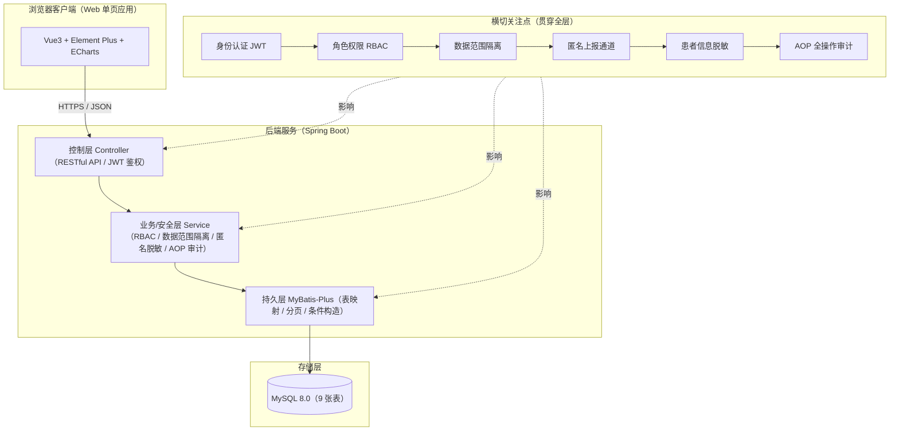

# 住院护理不良事件上报与根因辅助分析原型系统 · 总体设计方案

> 阶段：第二阶段交付（总体方案）　版本：V1.0　日期：2026-10
>
> ⚠ 声明：本系统仅用于教学模拟，不连接真实临床数据，不用于临床诊断或诊疗决策。

---

## 1. 系统定位与目标

- **定位**：B/S 架构的教学原型系统，覆盖护理不良事件"电子化填报 → 匿名上报 → 分级查看 → RCA 五维根因辅助分析 → 多维度统计"闭环；
- **目标能力**：需求建模、权限系统设计、表单开发、多维度统计分析；理解 RCA 在医疗安全中的应用；
- **非目标**：不接入 HIS/LIS/EMR，不做真实临床决策，不做海量并发。

---

## 2. 总体架构设计

采用**前后端分离 + 五层架构**，横切安全审计贯穿全层。



### 分层职责
| 层 | 技术 | 职责 |
| --- | --- | --- |
| 表现层 | Vue3 + Vite + Element Plus + Pinia + Axios | 表单、校验、脱敏展示、ECharts 图表 |
| 控制层 | Spring Boot Controller | RESTful API、JWT 鉴权、参数校验、统一响应 |
| 业务/安全层 | Service + Spring Security | RBAC 判定、数据范围隔离、匿名脱敏、AOP 审计 |
| 持久层 | MyBatis-Plus | 表映射、分页、条件构造器 |
| 存储层 | MySQL 8.0 | 9 张表落地 |

---

## 3. 技术栈选型与理由

| 维度 | 选型 | 理由 |
| --- | --- | --- |
| 前端 | Vue3 + Vite + Element Plus | 组件化表单、易做必填校验与脱敏展示 |
| 状态/请求 | Pinia + Axios | 轻量状态管理、统一拦截器处理 token |
| 图表 | ECharts | 科室×类型柱状图、损伤等级饼图、趋势折线、诱因词云 |
| 后端 | Spring Boot 3 + MyBatis-Plus | 贴合课程 Java 技术栈，便于权限/审计实践 |
| 安全 | Spring Security + JWT | 无状态鉴权、角色与数据范围控制 |
| 数据库 | MySQL 8.0 | 成熟稳定，支持外键/索引 |
| 审计 | Spring AOP / 拦截器 | 统一记录操作日志，低侵入 |

> **备选**：追求极简部署可降为 Flask + SQLite；仅界面原型可用纯前端 + Mock。本方案以 Spring Boot + Vue3 为主推，工程实践价值最高。

---

## 4. 功能模块划分

将课题 F1–F6 拆为 6 个模块，明确页面、核心职责与主要角色。

| 模块 | 对应功能 | 主要页面/职责 | 主要角色 |
| --- | --- | --- | --- |
| M1 用户与权限 | F1 | 登录、角色管理、科室管理 | ADMIN |
| M2 事件填报 | F2 | 填报表单（时间/科室/类型/等级/经过/现场）、必填校验、匿名开关 | NURSE |
| M3 RCA 分析 | F3 | 五维模板、时间序列表、鱼骨图、改进措施、状态机 | HEAD_NURSE / ADMIN |
| M4 检索筛选 | F4 | 多条件筛选（科室/类型/等级/时间），按角色隔离 | HEAD_NURSE / ADMIN |
| M5 统计分析 | F5 | 多维聚合图表、高频问题定位、导出 | HEAD_NURSE / ADMIN |
| M6 安全审计 | F6 | 脱敏展示、审计日志查看 | 系统（ADMIN 查看） |

---

## 5. 关键接口设计（RESTful 草案）

| 方法 | 路径 | 说明 | 权限 |
| --- | --- | --- | --- |
| POST | `/api/auth/login` | 登录获取 JWT | 公开 |
| POST | `/api/events` | 上报不良事件（支持匿名） | NURSE |
| GET | `/api/events` | 按角色范围检索（科室/类型/等级/时间） | 分级 |
| GET | `/api/events/{id}` | 事件明细（按角色脱敏） | 分级 |
| PUT | `/api/events/{id}` | 修改事件 | 分级 |
| POST | `/api/events/{id}/factors` | 写入五维诱因 | HEAD_NURSE/ADMIN |
| POST | `/api/events/{id}/rca` | 保存 RCA 根因+改进 | HEAD_NURSE/ADMIN |
| GET | `/api/stats/dept-type` | 科室×类型统计 | HEAD_NURSE/ADMIN |
| GET | `/api/stats/level` | 损伤等级分布 | HEAD_NURSE/ADMIN |
| GET | `/api/stats/trend` | 月度趋势 | HEAD_NURSE/ADMIN |
| GET | `/api/audit` | 审计日志查询 | ADMIN |
| POST | `/api/users` `/api/departments` | 用户/科室管理 | ADMIN |

> 所有写接口经 AOP 写 `sys_audit_log`；所有读接口按 `dataScope` 自动拼接部门条件。

---

## 6. 权限与安全详细设计

### 6.1 RBAC 三角色
- `NURSE`（普通护士）、`HEAD_NURSE`（科室护士长）、`ADMIN`（系统管理员）；
- 权限码控制菜单可见性与接口可访问性。

### 6.2 数据范围隔离（核心）
查询时在 SQL 层面按当前登录用户角色自动叠加部门条件：

```text
IF role = 'ADMIN'        → 无部门限制（全部事件）
IF role = 'HEAD_NURSE'   → WHERE dept_id = #{currentUser.deptId}   （仅本科室）
IF role = 'NURSE'        → WHERE dept_id = #{currentUser.deptId}
                          AND (reporter_id = #{currentUser.id} OR is_anonymous = 1)
                                                   （本人提交 + 本科室匿名事件，脱敏）
```

> 实现建议：MyBatis-Plus 自定义 `dataScope` 拦截器或 Service 内统一注入 `QueryWrapper` 条件，避免在每个接口重复拼接。

### 6.3 匿名上报机制
- 前端勾选"匿名" → 后端 `reporter_id = NULL`、`is_anonymous = 1`；
- 审计日志 `username = 'ANONYMOUS'`、`user_id = 0`，**不与任何 sys_user 关联**；
- 匿名事件在列表中仅以"匿名"标识，无法回溯上报人。

### 6.4 脱敏展示
- `patient` 表入库即脱敏（姓名/证件号/住院号）；
- 列表页对护士统一脱敏；明细页按角色授权展示更多信息；
- 审计 `req_param` 写入前对敏感字段脱敏。

### 6.5 AOP 全操作审计
- 拦截 `LOGIN / REPORT / VIEW / UPDATE / DELETE / EXPORT` 六类动作；
- 写入 `sys_audit_log`：操作人、角色、部门、对象类型/ID、脱敏参数、IP、时间；
- 低侵入：通过注解（如 `@Audit(actionType=...)`）或拦截器统一织入。

### 6.6 越权防护
- 接口层校验"目标事件 dept_id 是否属于当前用户可见范围"，越权返回 403；
- 关键写操作二次校验，防止通过 ID 遍历越权访问他人科室数据。

---

## 7. RCA 辅助分析实现方案

- **五维模板**：人/机/料/法/环 文本域，逐一记录诱因 → 落 `event_factor`（dimension 字段）；
- **时间序列表**：结构化还原事件经过 → 落 `rca_record.timeline`；
- **鱼骨图**：基于五维诱因用 ECharts 渲染，直观定位主因；
- **根因与改进**：五维根本原因（root_human…root_env）+ 改进措施 → 落 `rca_record`；
- **状态机**：`NOT_STARTED → ANALYZING → DONE`，驱动分析闭环并纳入统计。

---

## 8. 统计分析实现方案

| 图表 | 维度 | 目的 |
| --- | --- | --- |
| 柱状图 | 科室 × 事件类型 | 定位高发科室与事件类型 |
| 饼图 | 损伤等级分布 | 掌握严重程度构成 |
| 折线图 | 月度趋势 | 观察时间变化 |
| 词云 | 高频诱因 | 提炼人/机/料/法/环集中问题 |

- 数据来源：`adverse_event` + `event_factor` + `rca_record`，按角色数据范围聚合；
- 支持图表导出（图片/Excel），供护理安全管理汇报。

---

## 9. 部署与运行环境

| 项目 | 建议 |
| --- | --- |
| 后端运行 | JDK 17 + Spring Boot 3（内嵌 Tomcat） |
| 前端运行 | Node.js + Vite dev / 构建静态资源 |
| 数据库 | MySQL 8.0（执行 `sql/01_init.sql` 建库） |
| 部署形态 | 单机演示：前后端同机；教学演示可用 Docker Compose 一键起 |
| 演示账号 | 预置 NURSE / HEAD_NURSE / ADMIN 三类示例账号（脚本或初始化接口） |

---

## 10. 与需求/数据库设计的衔接

- **需求分析**（`需求分析与总体设计.html` 第 1–2 章）给出用例与流程，本方案据此划模块、定接口；
- **数据库设计**（`数据库设计.md` + `sql/01_init.sql`）为本方案的 9 张表落地依据；
- 三者一致：功能（F1–F6）→ 模块（M1–M6）→ 接口 → 表（9 张），权限约束在三层统一体现。
