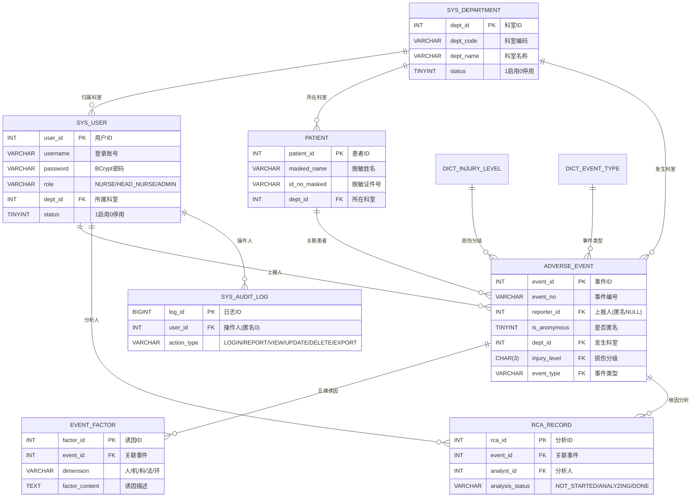

# 住院护理不良事件上报与根因辅助分析原型系统 · 数据库设计说明书

> 阶段：第二阶段交付（数据库设计）　版本：V1.0　日期：2026-10
>
> ⚠ 声明：本系统仅用于教学模拟，不连接真实临床数据，不用于临床诊断或诊疗决策。

---

## 1. 设计概述

### 1.1 设计目标
- 支撑"填报 → 匿名 → 校验 → 入库 → 分级查看 → RCA 分析 → 统计"全链路数据落地；
- 以**分级权限 + 数据范围隔离**为约束建模，确保护士/护士长/管理员三级可见性；
- 患者信息**脱敏存储**，审计日志**全操作留痕**；
- 为 RCA 的"人-机-料-法-环"五维诱因提供结构化采集表。

### 1.2 设计原则
1. **第三范式为主**：实体独立成表，字典与主表分离，避免冗余；
2. **字典外键化**：损伤分级、事件类型、科室均建字典表，主表以编码/ID 引用；
3. **范围隔离可下推**：`sys_user.dept_id` 与 `adverse_event.dept_id` 同源于 `sys_department`，查询时按部门拼接条件实现隔离；
4. **匿名无身份关联**：匿名事件 `reporter_id = NULL`，审计记 `ANONYMOUS`；
5. **脱敏入库**：患者姓名/证件号/住院号入库即脱敏，不存明文。

### 1.3 命名规范
- 表名：`sys_` 系统类、`dict_` 字典类、业务表用小写英文（如 `adverse_event`）；
- 字段：`snake_case`；主键统一 `xxx_id`（自增 INT）或业务编码；
- 外键命名与引用表主键一致（如 `dept_id` 引用 `sys_department.dept_id`）；
- 状态/类型字段用 `VARCHAR` 枚举串，便于扩展与阅读。

### 1.4 运行环境
- 数据库：**MySQL 8.0**（utf8mb4 / InnoDB）；
- 建库脚本：`nursing-ae-system/sql/01_init.sql`（本说明书与之逐表对应）。

---

## 2. E-R 图

> 基数含义：`||--o{` 表示一端(字典/用户)对多端(业务表)的 1:N 关系；箭头方向即外键引用方向（多端 → 一端）。完整矢量图见 `diagrams/er.svg`。

---

## 3. 表结构详细设计

> 字段表列含义：字段名 | 数据类型 | 允许空 | 键 | 默认值 | 说明。

### 3.1 科室字典表 `sys_department`
支撑"按科室隔离与统计"的基础字典。

| 字段名 | 数据类型 | 允许空 | 键 | 默认值 | 说明 |
| --- | --- | --- | --- | --- | --- |
| dept_id | INT | 否 | PK | AUTO_INCREMENT | 科室ID（主键） |
| dept_code | VARCHAR(32) | 否 | UNIQUE | — | 科室编码（如 N-01） |
| dept_name | VARCHAR(64) | 否 | | — | 科室名称 |
| status | TINYINT | 否 | | 1 | 状态 1启用 0停用 |
| create_time | DATETIME | 否 | | CURRENT_TIMESTAMP | 创建时间 |

索引：主键 `dept_id`；唯一索引 `dept_code`。

### 3.2 系统用户表 `sys_user`
三角色（护士/护士长/管理员），密码 BCrypt 加密。

| 字段名 | 数据类型 | 允许空 | 键 | 默认值 | 说明 |
| --- | --- | --- | --- | --- | --- |
| user_id | INT | 否 | PK | AUTO_INCREMENT | 用户ID |
| username | VARCHAR(64) | 否 | UNIQUE | — | 登录账号 |
| password | VARCHAR(128) | 否 | | — | 密码（BCrypt 加密） |
| real_name | VARCHAR(32) | 是 | | NULL | 真实姓名 |
| role | VARCHAR(20) | 否 | | — | NURSE / HEAD_NURSE / ADMIN |
| dept_id | INT | 是 | FK | NULL | 所属科室（管理员可空） |
| phone | VARCHAR(20) | 是 | | NULL | 联系电话 |
| status | TINYINT | 否 | | 1 | 1启用 0停用 |
| create_time | DATETIME | 否 | | CURRENT_TIMESTAMP | 创建时间 |

外键：`dept_id → sys_department(dept_id)`。

### 3.3 模拟患者信息表 `patient`
**脱敏存储**，仅教学模拟，不存真实患者数据。

| 字段名 | 数据类型 | 允许空 | 键 | 默认值 | 说明 |
| --- | --- | --- | --- | --- | --- |
| patient_id | INT | 否 | PK | AUTO_INCREMENT | 患者ID |
| masked_name | VARCHAR(32) | 是 | | NULL | 脱敏姓名（如 张*） |
| gender | VARCHAR(4) | 是 | | NULL | 男/女 |
| age | INT | 是 | | NULL | 年龄 |
| bed_no | VARCHAR(16) | 是 | | NULL | 床号 |
| admission_no | VARCHAR(32) | 是 | | NULL | 住院号（脱敏） |
| dept_id | INT | 是 | FK | NULL | 所在科室 |
| diagnosis | VARCHAR(255) | 是 | | NULL | 主要诊断 |
| id_no_masked | VARCHAR(32) | 是 | | NULL | 身份证号脱敏（如 110***********1234） |

外键：`dept_id → sys_department(dept_id)`。

### 3.4 不良事件主表 `adverse_event`（核心业务表）

| 字段名 | 数据类型 | 允许空 | 键 | 默认值 | 说明 |
| --- | --- | --- | --- | --- | --- |
| event_id | INT | 否 | PK | AUTO_INCREMENT | 事件ID |
| event_no | VARCHAR(32) | 否 | UNIQUE | — | 事件编号（系统生成） |
| reporter_id | INT | 是 | FK | NULL | 上报人（匿名时 NULL） |
| reporter_role | VARCHAR(20) | 是 | | NULL | 上报人角色快照 |
| is_anonymous | TINYINT | 否 | | 0 | 是否匿名 1匿名 0实名 |
| dept_id | INT | 否 | FK | — | 事件发生科室 |
| patient_id | INT | 是 | FK | NULL | 关联患者（可空） |
| event_type | VARCHAR(32) | 否 | FK | — | 事件类型编码 |
| injury_level | CHAR(3) | 否 | FK | — | 损伤分级 I/II/III/IV |
| occur_time | DATETIME | 否 | | — | 事件发生时间 |
| event_desc | TEXT | 否 | | — | 事件经过 |
| scene_desc | TEXT | 是 | | NULL | 现场情况 |
| status | VARCHAR(20) | 否 | | REPORTED | REPORTED/REVIEWING/ANALYZED/CLOSED |
| create_time | DATETIME | 否 | | CURRENT_TIMESTAMP | 创建时间 |
| update_time | DATETIME | 否 | | CURRENT_TIMESTAMP | 更新时间（自动） |

外键：
- `dept_id → sys_department(dept_id)`
- `patient_id → patient(patient_id)`
- `reporter_id → sys_user(user_id)`
- `injury_level → dict_injury_level(level_code)`
- `event_type → dict_event_type(type_code)`

索引：`idx_dept(dept_id)`、`idx_type(event_type)`、`idx_level(injury_level)`、`idx_occur(occur_time)`。

### 3.5 事件损伤分级字典表 `dict_injury_level`
采用中国医院协会四级标准。

| 字段名 | 数据类型 | 允许空 | 键 | 默认值 | 说明 |
| --- | --- | --- | --- | --- | --- |
| level_code | CHAR(3) | 否 | PK | — | 分级代码 I/II/III/IV |
| level_name | VARCHAR(32) | 否 | | — | 分级名称 |
| level_desc | VARCHAR(255) | 是 | | NULL | 分级说明 |
| sort_no | INT | 否 | | 0 | 展示排序 |

### 3.6 不良事件类型字典表 `dict_event_type`

| 字段名 | 数据类型 | 允许空 | 键 | 默认值 | 说明 |
| --- | --- | --- | --- | --- | --- |
| type_id | INT | 否 | PK | AUTO_INCREMENT | 类型ID |
| type_code | VARCHAR(32) | 否 | UNIQUE | — | 类型编码（如 FALL） |
| type_name | VARCHAR(64) | 否 | | — | 类型名称（如 跌倒） |
| category | VARCHAR(32) | 是 | | NULL | 所属大类 |
| sort_no | INT | 否 | | 0 | 展示排序 |

### 3.7 事件诱因记录表 `event_factor`
采集"人-机-料-法-环"五维近端诱因。

| 字段名 | 数据类型 | 允许空 | 键 | 默认值 | 说明 |
| --- | --- | --- | --- | --- | --- |
| factor_id | INT | 否 | PK | AUTO_INCREMENT | 诱因ID |
| event_id | INT | 否 | FK | — | 关联事件 |
| dimension | VARCHAR(8) | 否 | | — | 人/机/料/法/环 |
| factor_type | VARCHAR(16) | 是 | | PROXIMAL | PROXIMAL近端 / ROOT根本 |
| factor_content | TEXT | 否 | | — | 诱因描述 |
| create_time | DATETIME | 否 | | CURRENT_TIMESTAMP | 创建时间 |

外键：`event_id → adverse_event(event_id)`；索引 `idx_event(event_id)`。

### 3.8 RCA 根因分析记录表 `rca_record`
沉淀五维根本原因 + 时间序列表 + 改进措施。

| 字段名 | 数据类型 | 允许空 | 键 | 默认值 | 说明 |
| --- | --- | --- | --- | --- | --- |
| rca_id | INT | 否 | PK | AUTO_INCREMENT | 分析ID |
| event_id | INT | 否 | FK | — | 关联事件 |
| analyst_id | INT | 是 | FK | NULL | 分析人（护士长/管理员） |
| timeline | TEXT | 是 | | NULL | 时间序列表（还原经过） |
| root_human | TEXT | 是 | | NULL | 人-根本原因 |
| root_machine | TEXT | 是 | | NULL | 机-根本原因 |
| root_material | TEXT | 是 | | NULL | 料-根本原因 |
| root_method | TEXT | 是 | | NULL | 法-根本原因 |
| root_env | TEXT | 是 | | NULL | 环-根本原因 |
| improvement | TEXT | 是 | | NULL | 改进措施 |
| analysis_status | VARCHAR(20) | 否 | | NOT_STARTED | NOT_STARTED/ANALYZING/DONE |
| create_time | DATETIME | 否 | | CURRENT_TIMESTAMP | 创建时间 |
| update_time | DATETIME | 否 | | CURRENT_TIMESTAMP | 更新时间（自动） |

外键：`event_id → adverse_event(event_id)`、`analyst_id → sys_user(user_id)`；索引 `idx_event(event_id)`。

### 3.9 系统操作审计日志表 `sys_audit_log`
填报/查看/修改/删除/导出全留痕。

| 字段名 | 数据类型 | 允许空 | 键 | 默认值 | 说明 |
| --- | --- | --- | --- | --- | --- |
| log_id | BIGINT | 否 | PK | AUTO_INCREMENT | 日志ID |
| user_id | INT | 是 | | NULL | 操作人（匿名记 0） |
| username | VARCHAR(64) | 是 | | NULL | 操作人账号（匿名 ANONYMOUS） |
| role | VARCHAR(20) | 是 | | NULL | 操作人角色 |
| dept_id | INT | 是 | | NULL | 操作人科室 |
| action_type | VARCHAR(32) | 否 | | — | LOGIN/REPORT/VIEW/UPDATE/DELETE/EXPORT |
| target_type | VARCHAR(32) | 是 | | NULL | 事件/患者/用户/字典 |
| target_id | VARCHAR(32) | 是 | | NULL | 操作对象ID |
| req_param | TEXT | 是 | | NULL | 请求参数（敏感字段已脱敏） |
| ip_addr | VARCHAR(64) | 是 | | NULL | 客户端IP |
| create_time | DATETIME | 否 | | CURRENT_TIMESTAMP | 创建时间 |

索引：`idx_user(user_id)`、`idx_action(action_type)`、`idx_time(create_time)`。

---

## 4. 外键与关联关系汇总

| 子表 | 外键字段 | 引用父表 | 关系 |
| --- | --- | --- | --- |
| sys_user | dept_id | sys_department | 1:N |
| patient | dept_id | sys_department | 1:N |
| adverse_event | dept_id | sys_department | 1:N |
| adverse_event | reporter_id | sys_user | 1:N |
| adverse_event | patient_id | patient | 1:N |
| adverse_event | injury_level | dict_injury_level | 1:N |
| adverse_event | event_type | dict_event_type | 1:N |
| event_factor | event_id | adverse_event | 1:N |
| rca_record | event_id | adverse_event | 1:N |
| rca_record | analyst_id | sys_user | 1:N |
| sys_audit_log | user_id | sys_user | 1:N |

---

## 5. 初始化字典数据

脚本 `01_init.sql` 内置以下教学示例数据（可直接演示，不参与任何真实统计）：

**损伤分级（中国医院协会四级）**

| 代码 | 名称 | 说明 |
| --- | --- | --- |
| I | 警告事件（Ⅰ级） | 非预期死亡或永久性功能丧失 |
| II | 不良后果事件（Ⅱ级） | 诊疗造成机体与功能损害 |
| III | 未造成后果事件（Ⅲ级） | 发生错误但未造成损害 |
| IV | 隐患事件（Ⅳ级） | 及时发现错误、未形成事实（Near-miss） |

**事件类型（聚焦题目四类 + 常见类）**

| 编码 | 名称 | 大类 |
| --- | --- | --- |
| FALL | 跌倒 | 意外事件 |
| PRESSURE | 压疮 | 皮肤护理 |
| INFIL | 输液外渗 | 静脉治疗 |
| FALL_BED | 坠床 | 意外事件 |
| WRONG_DRUG | 给药错误 | 不良治疗 |
| TUBE | 管路滑脱 | 管道护理 |
| OTHER | 其他 | 其他 |

**科室示例**：内科一病区(N-01)、内科二病区(N-02)、外科一病区(S-01)、重症医学科(ICU)、护理部(ADMIN)。

---

## 6. 与建库脚本的对应关系

- 本说明书 9 张表的字段、类型、约束、索引与 `sql/01_init.sql` **逐列一致**；
- 落地方式：在 MySQL 8.0 执行 `01_init.sql` 即可一次性建库（`nursing_ae_db`）+ 建表 + 外键 + 索引 + 字典初始化；
- 如需在文档中直接查看 DDL，可打开 `sql/01_init.sql`（192 行，含注释）。

---

## 7. 隐私保护与脱敏存储说明

- **入库即脱敏**：`patient` 表的姓名、证件号、住院号以脱敏形态存储，系统不接收明文敏感信息；
- **列表脱敏**：事件列表页对护士角色统一脱敏展示，明细页按权限授权；
- **匿名无关联**：勾选匿名后 `reporter_id=NULL`，审计 `username='ANONYMOUS'`，无法回溯到具体上报人；
- **审计参数脱敏**：`sys_audit_log.req_param` 中患者姓名/证件号等敏感字段写入前已做脱敏；
- **教学边界**：所有数据均为模拟，数据库及接口显著标注"教学模拟，不用于临床"。
