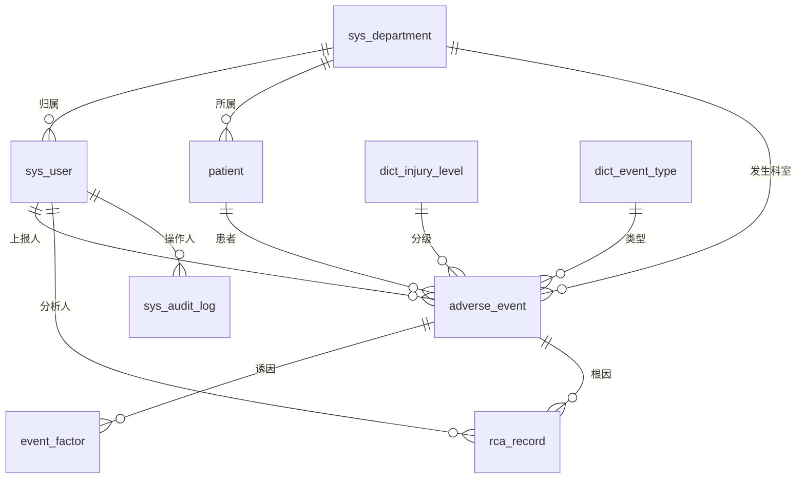

# 住院护理不良事件上报与根因辅助分析原型系统  
### 课题计划书（医学信息课程设计）

> **Inpatient Nursing Adverse Event Reporting & RCA-Assisted Analysis Prototype**

| 项目 | 内容 |
| --- | --- |
| 课程名称 | 医学信息（课程设计） |
| 设计题目 | 住院护理不良事件上报与根因辅助分析原型系统 |
| 适用对象 | 护理 / 医学信息相关专业的教学原型 |
| 完成日期 | 2026 年 10 月 |
| 声明 | ⚠ 本系统仅用于教学模拟，不连接真实临床数据，不用于临床诊断或诊疗决策。 |

---

## 目录

1. [设计目的](#1-设计目的)
2. [课题背景](#2-课题背景)
   - 2.1 [护理不良事件与上报现状痛点](#21-护理不良事件与上报现状痛点)
   - 2.2 [根因分析（RCA）在医疗安全中的应用](#22-根因分析rca在医疗安全中的应用)
   - 2.3 [隐私保护与分级权限的工程意义](#23-隐私保护与分级权限的工程意义)
3. [相关资料调研综述](#3-相关资料调研综述)
   - 3.1 [护理不良事件定义与分类](#31-护理不良事件定义与分类)
   - 3.2 [损伤分级标准（中国医院协会四级）](#32-损伤分级标准中国医院协会四级)
   - 3.3 [RCA 方法论：人-机-料-法-环](#33-rca-方法论人机料法环)
   - 3.4 [电子化上报与匿名上报机制](#34-电子化上报与匿名上报机制)
   - 3.5 [隐私保护与分级权限合规要求](#35-隐私保护与分级权限合规要求)
4. [需求分析](#4-需求分析)
   - 4.1 [业务角色与流程](#41-业务角色与流程)
   - 4.2 [功能需求列表](#42-功能需求列表)
   - 4.3 [非功能需求](#43-非功能需求)
5. [数据库设计](#5-数据库设计)
   - 5.1 [ER 图](#51-er-图)
   - 5.2 [数据表清单与字段说明](#52-数据表清单与字段说明)
   - 5.3 [建库脚本](#53-建库脚本)
6. [技术方案](#6-技术方案)
   - 6.1 [总体架构](#61-总体架构)
   - 6.2 [技术栈选型](#62-技术栈选型)
   - 6.3 [权限与安全设计](#63-权限与安全设计)
   - 6.4 [RCA 辅助分析实现](#64-rca-辅助分析实现)
   - 6.5 [统计分析图表方案](#65-统计分析图表方案)
7. [业务功能模块详细设计](#7-业务功能模块详细设计)
   - 7.1 [用户权限管理](#71-用户权限管理)
   - 7.2 [不良事件填报表单](#72-不良事件填报表单)
   - 7.3 [RCA 根因辅助分析模块](#73-rca-根因辅助分析模块)
   - 7.4 [事件检索筛选](#74-事件检索筛选)
   - 7.5 [统计分析功能](#75-统计分析功能)
   - 7.6 [安全约束](#76-安全约束)
8. [测试计划](#8-测试计划)
   - 8.1 [测试场景设计](#81-测试场景设计)
   - 8.2 [权限隔离验证](#82-权限隔离验证)
   - 8.3 [测试报告结构](#83-测试报告结构)
9. [进度安排](#9-进度安排)
10. [预期成果与教学价值](#10-预期成果与教学价值)
11. [参考文献](#11-参考文献)

---

## 1. 设计目的

针对护理不良事件**上报流程繁琐、上报意愿低、缺少电子化根因分析辅助工具**的业务现状，本课程设计旨在实现一个"住院护理不良事件上报与根因辅助分析原型系统"。通过该系统的分析与构建，达成以下教学目的：

- 掌握**医疗事件类信息系统**的需求建模方法（角色、用例、业务流程、数据建模）；
- 理解并实践**权限系统设计**：基于角色的访问控制（RBAC）与数据范围隔离，落实分级权限；
- 掌握**结构化表单开发**：必填校验、关键字段约束、匿名上报选项；
- 完成**多维度统计分析**：按科室、类型、损伤等级、时间区间聚合，输出可视化图表定位高频安全问题；
- 理解 **RCA 根本原因分析（Root Cause Analysis）** 在医疗安全中的应用，体会医疗安全管理业务；
- 强化**医疗隐私保护**与**分级权限控制**的工程实践能力。

---

## 2. 课题背景

### 2.1 护理不良事件与上报现状痛点

护理不良事件包含**跌倒、压疮、输液外渗、坠床**等。传统纸质上报流程复杂、填写项多，事后汇总统计工作量巨大。据行业调研，当前医疗安全管理普遍面临以下痛点：

- **上报率低、耗时长：** 纸质或复杂电子表单让一线护士"报一次十几分钟"，挤压临床时间，导致主动上报意愿低；
- **匿名保障不足：** 纸质记录或权限痕迹可能暴露上报者身份，抑制"非惩罚性"上报文化，形成"沉默螺旋"；
- **分析辅助工具缺失：** 手工绘制鱼骨图缺乏多维度数据支撑，常将复杂事件简单归咎于个人操作失误，忽视流程、设备、环境等系统性因素；
- **闭环断裂：** "分析—改进"传导链断裂，整改措施常停留在纸面，同类隐患反复发生。

> **设计切入点：** 用"移动端/Web 轻量填报 + 匿名通道 + 内置 RCA 五维模板 + 自动统计"破解上述痛点，把上报成本降到最低、把根因分析变成结构化引导。

### 2.2 根因分析（RCA）在医疗安全中的应用

RCA 起源于"瑞士乳酪理论"，是一种**基于团体、系统、回顾性的不良事件分析方法**。其核心不是追责个人，而是找出系统/流程中的风险与漏洞，从源头改进，预防同类事件再次发生。RCA 关注 5W1H：发生了什么（What）、在谁身上（Who）、何时（When）、何地（Where）、为何发生（Why）、如何杜绝（How）。

### 2.3 隐私保护与分级权限的工程意义

患者安全事件涉及敏感个人信息。国家卫生健康委要求落实**电子病历信息分级分类访问控制与权限管理**，遵循"最小可用原则"，严禁未经授权查阅、复制、传播。本原型将"患者信息脱敏展示 + 分级数据范围隔离 + 全操作审计留痕"作为安全基线，使学员在原型开发中建立合规意识。

---

## 3. 相关资料调研综述

### 3.1 护理不良事件定义与分类

国内普遍认为：护理不良事件是在护理过程中发生的、非计划内、未预计到的事件，包括住院期间发生的跌倒、坠床、给药错误、输液/输血意外、管路滑脱、走失、误吸、烫伤等。按事件性质，常用分类（共 10 大类）如下：

| 大类 | 典型事件 | 与本题关联 |
| --- | --- | --- |
| 1 不良治疗 | 给药错误、输血错误、输液/输血反应 | 输液外渗属静脉治疗相关 |
| 2 意外事件 | 跌倒、坠床、走失、烫伤 | 本题核心：跌倒、坠床 |
| 3 护患沟通事件 | 护患争吵、暴力行为 | — |
| 4 饮食/皮肤护理 | 误吸/窒息、院内压疮 | 本题核心：压疮 |
| 5 辅助诊查/转运 | 身份识别错误、标本丢失 | — |
| 6 管道护理 | 管道滑脱、自行拔管 | — |
| 7 职业暴露 | 针刺伤、割伤 | — |
| 8 公共设施 | 设施故障、有害物质泄漏 | — |
| 9 医疗设备器械 | 仪器故障、器械不达标 | RCA"机"维度 |
| 10 供应不良 | 消毒不达标、器械包不符 | — |

### 3.2 损伤分级标准（中国医院协会四级）

国内普遍采用中国医院协会标准，按事件严重程度由轻至重分为 4 级，本原型的"损伤分级字典表"即依此建模：

| 级别 | 名称 | 定义 |
| --- | --- | --- |
| **Ⅰ级** | 警告事件 | 非预期的死亡，或非疾病自然进展造成永久性功能丧失 |
| **Ⅱ级** | 不良后果事件 | 诊疗活动中因诊疗（非疾病本身）造成患者机体与功能损害 |
| **Ⅲ级** | 未造成后果事件 | 发生错误事实，但未造成机体与功能损害 |
| **Ⅳ级** | 隐患事件 | 及时发现错误、未形成事实（近似错误 / Near-miss） |

> **教学要点：** Ⅳ级"隐患事件/近似错误"是上报意愿最低但价值最高的数据，原型通过"匿名 + 低门槛"专门鼓励此类上报。

### 3.3 RCA 方法论：人-机-料-法-环

RCA 从"人、机、料、法、环"五维度（部分扩展为六维加"测"）分析事故诱因，并辅以**鱼骨图**与**时间序列表**。本原型将五维度做成结构化填报模板，引导填写人员记录事件各类诱因，沉淀根因分析记录。

| 维度 | 含义 | 护理场景示例 |
| --- | --- | --- |
| 人 | 人员因素 | 低年资护士风险认知不足、查对制度落实不到位 |
| 机 | 设备因素 | 输液泵无渗漏预警、无血管可视化辅助设备 |
| 料 | 物料因素 | 高渗药物（如 10% 葡萄糖酸钙）、穿刺静脉管径细小 |
| 法 | 方法/制度 | 标准化流程缺失、交接班制度执行不严 |
| 环 | 环境因素 | 夜间照明不足、地面湿滑、病区布局不合理 |

### 3.4 电子化上报与匿名上报机制

WHO 患者安全建议：上报系统应**匿名、易用、全员可访问、基于非惩罚文化**。研究表明，匿名保障缺失是抑制上报意愿的关键因素之一；而电子平台支持实时类型/时间/地点/人员/情境分析，能显著提升患者安全指标（如降低跌倒率、减少用药错误）。本原型据此设置"匿名上报"开关：勾选后系统不绑定上报人身份，审计日志以"ANONYMOUS"记录，杜绝身份追溯。

### 3.5 隐私保护与分级权限合规要求

- **去辨識原则：** 姓名、身份证号、电话、地址、病历号、床号等可辨识信息，以代号替代或脱敏，至无法推测原始信息；
- **分级权限：** 按角色与岗位设置分级访问权限，遵循"最小可用原则"；
- **全链路留痕：** 填报、查看、修改、删除、导出等操作记录审计日志，实现可追溯、不可篡改。

---

## 4. 需求分析

### 4.1 业务角色与流程

系统三类角色：`普通护士 NURSE` · `科室护士长 HEAD_NURSE` · `系统管理员 ADMIN`。核心业务流程：

```
事件发生 → 护士填报（可匿名）→ 系统必填校验 → 写入主表+审计
→ 护士长/管理员查看（按范围隔离）→ 触发 RCA 分析（五维模板）
→ 生成改进措施 → 统计分析/图表 → 闭环
```

### 4.2 功能需求列表

| 编号 | 功能模块 | 关键需求 |
| --- | --- | --- |
| F1 | 用户权限管理 | 三角色；数据访问范围隔离；支持匿名上报选项 |
| F2 | 不良事件填报表单 | 事件时间/科室/类型/损伤等级/经过/现场；必填校验 |
| F3 | RCA 根因辅助分析 | 人-机-料-法-环 五维模板；时间序列表；保存分析记录 |
| F4 | 事件检索筛选 | 按科室/类型/损伤等级/时间区间筛选；护士长仅本科室，管理员全部 |
| F5 | 统计分析 | 各科室各类事件数量；图表定位高频安全问题 |
| F6 | 安全约束 | 患者信息脱敏；全操作审计日志 |

### 4.3 非功能需求

- **隐私合规：** 患者姓名/证件号脱敏存储与展示；敏感字段在审计参数中脱敏；
- **权限正确：** 越权访问必须被拒绝并返回无权限提示；
- **易用性：** 填报核心信息 3 分钟内可完成，支持匿名；
- **性能：** 原型数据量小，统计查询响应 < 1s；
- **教学模拟：** 全部为模拟数据，界面显著标注"教学模拟，不用于临床"。

---

## 5. 数据库设计

依据课题要求，设计 7 张核心表（用户表、模拟患者信息表、不良事件主表、损伤分级字典表、事件诱因记录表、RCA 根因分析记录表、审计日志），并为支撑"按科室隔离与统计"补充**科室字典表**与**事件类型字典表**，共 9 张表。

### 5.1 ER 图

> 下图使用 Mermaid 语法（GitHub / Typora / VS Code 等 Markdown 阅读器可直接渲染）。HTML 与 Word 版本另含矢量 SVG 原图。



实体清单：

- `sys_department`（科室字典）— dept_id / dept_code / dept_name / status
- `sys_user`（系统用户）— user_id / username / password / role / dept_id / status
- `patient`（模拟患者）— patient_id / masked_name / gender / age / bed_no / id_no_masked
- `adverse_event`（不良事件主表，中心表）— event_id / event_no / reporter_id / is_anonymous / dept_id / patient_id / event_type / injury_level / occur_time / event_desc / scene_desc / status
- `dict_injury_level`（损伤分级字典）— level_code / level_name / level_desc / sort_no
- `dict_event_type`（事件类型字典）— type_id / type_code / type_name / category
- `event_factor`（事件诱因记录）— factor_id / event_id / dimension / factor_type / factor_content
- `rca_record`（RCA 根因分析记录）— rca_id / event_id / analyst_id / timeline / root_human / root_machine / root_material / root_method / root_env / improvement / analysis_status
- `sys_audit_log`（审计日志）— log_id / user_id / username / role / action_type / target_type / target_id / req_param / ip_addr

### 5.2 数据表清单与字段说明

| 表名 | 中文 | 核心字段 | 说明 |
| --- | --- | --- | --- |
| `sys_user` | 用户表 | user_id, username, password, role, dept_id, status | 三角色；密码 BCrypt 加密 |
| `patient` | 模拟患者信息表 | patient_id, masked_name, gender, age, bed_no, id_no_masked | 脱敏存储 |
| `adverse_event` | 不良事件主表 | event_id, event_no, reporter_id, is_anonymous, dept_id, patient_id, event_type, injury_level, occur_time, event_desc, scene_desc, status | 核心业务表 |
| `dict_injury_level` | 损伤分级字典表 | level_code, level_name, level_desc, sort_no | Ⅰ/Ⅱ/Ⅲ/Ⅳ 级 |
| `event_factor` | 事件诱因记录表 | factor_id, event_id, dimension, factor_type, factor_content | 五维诱因采集 |
| `rca_record` | RCA 根因分析记录表 | rca_id, event_id, analyst_id, timeline, root_human/machine/material/method/env, improvement, analysis_status | 五维根因+改进 |
| `sys_audit_log` | 系统操作审计日志 | log_id, user_id, username, role, action_type, target_type, target_id, req_param, ip_addr | 全操作留痕 |
| `sys_department` | 科室字典表 | dept_id, dept_code, dept_name, status | 支撑隔离/统计 |
| `dict_event_type` | 事件类型字典表 | type_id, type_code, type_name, category | 跌倒/压疮/外渗/坠床等 |

### 5.3 建库脚本

> **交付物：** 完整 MySQL 8.0 建库脚本已随本计划书一同提供，文件路径 `nursing-ae-system/sql/01_init.sql`，含 9 张表 DDL、外键约束、索引与字典初始化数据。

---

## 6. 技术方案

### 6.1 总体架构

采用**前后端分离**的 B/S 架构：

| 层 | 职责 |
| --- | --- |
| 表现层 | Vue3 + Element Plus 单页应用：填报、检索、RCA 表单、统计图表 |
| 控制层 | Spring Boot Controller：RESTful API、JWT 鉴权、参数校验 |
| 业务/安全层 | Service + Spring Security：权限判定、数据范围隔离、匿名脱敏、AOP 审计 |
| 持久层 | MyBatis-Plus：表映射、分页、条件构造 |
| 存储层 | MySQL 8.0：9 张表 |

### 6.2 技术栈选型

| 维度 | 选型 | 理由 |
| --- | --- | --- |
| 前端 | Vue3 + Vite + Element Plus + Pinia + Axios | 组件化表单、易做必填校验与脱敏展示 |
| 图表 | ECharts | 各科室/类型柱状图、损伤等级饼图、时间趋势折线 |
| 后端 | Spring Boot 3 + MyBatis-Plus | 贴合课程 Java 技术栈，便于权限/审计实践 |
| 安全 | Spring Security + JWT | 无状态鉴权、角色与数据范围控制 |
| 数据库 | MySQL 8.0 | 成熟稳定，支持外键/索引 |
| 审计 | Spring AOP / 拦截器 | 统一记录操作日志 |

> **备选方案：** 若追求极简部署，可降为 Flask + SQLite + 原生前端；若仅做界面原型，可用纯前端 + Mock 数据。本计划书以 Spring Boot + Vue3 为主推方案，工程实践价值最高。

### 6.3 权限与安全设计

- **RBAC 角色：** `NURSE / HEAD_NURSE / ADMIN`，权限码控制菜单与接口；
- **数据范围隔离：** 查询自动叠加部门条件——护士仅本人提交及本科室脱敏列表；护士长仅本科室全部；管理员全部；
- **匿名上报：** 前端勾选"匿名"→ 后端 `reporter_id=NULL`，审计以 `ANONYMOUS` 记录，无任何身份关联；
- **脱敏展示：** 患者姓名/证件号/住院号脱敏存储与列表脱敏；明细页按角色授权展示；
- **审计全留痕：** AOP 拦截填报/查看/修改/删除/导出，写入 `sys_audit_log`，敏感参数脱敏。

### 6.4 RCA 辅助分析实现

RCA 模块以"五维模板 + 时间序列表 + 鱼骨图"实现辅助分析：

- 表单：人/机/料/法/环 五个文本域，引导填写近端原因与根本原因；
- 时间序列表：按时间轴还原事件经过（结构化输入）；
- 鱼骨图：基于五维数据用 ECharts 渲染可视化，辅助汇报；
- 保存：写入 `event_factor`（诱因）与 `rca_record`（根因+改进措施），状态机 NOT_STARTED→ANALYZING→DONE。

### 6.5 统计分析图表方案

| 图表 | 维度 | 用途 |
| --- | --- | --- |
| 柱状图 | 各科室 × 各事件类型 数量 | 定位高频安全问题与薄弱科室 |
| 饼图 | 损伤等级分布（Ⅰ-Ⅳ） | 评估严重程度构成 |
| 折线图 | 按月的事件趋势 | 观察改进前后变化 |
| 词云/列表 | 高频诱因关键词 | 辅助 RCA 方向 |

---

## 7. 业务功能模块详细设计

### 7.1 用户权限管理

- 三角色数据访问范围：护士（本人+本科室脱敏）、护士长（本科室全部）、管理员（全部+用户管理）；
- 登录鉴权（JWT），密码加密；支持"匿名上报"选项，不改变登录态但上报时不绑定身份。

### 7.2 不良事件填报表单

- 字段：事件发生时间、科室、事件类型、损伤等级、事件经过、现场情况；
- 必填校验：上述关键字段不能为空；时间不晚于当前；类型/等级下拉取自字典表；
- 提交即写主表 + 审计日志；可选匿名。

### 7.3 RCA 根因辅助分析模块

- 提供"人-机-料-法-环"五维填报模板；
- 引导记录事件各类诱因，保存至 `event_factor` 与 `rca_record`；
- 生成时间序列表与鱼骨图，输出改进措施。

### 7.4 事件检索筛选

- 按科室、事件类型、损伤等级、时间区间组合筛选；
- 护士长仅可查看本科室事件；管理员查看全部；列表展示脱敏患者信息。

### 7.5 统计分析功能

- 统计各科室各类不良事件发生数量；
- 输出柱状/饼/折线等图表，定位高频安全问题，支持导出统计结果。

### 7.6 安全约束

- 患者信息脱敏展示（姓名/证件号/住院号）；
- 所有填报、查看、修改、删除、导出操作记录审计日志。

---

## 8. 测试计划

### 8.1 测试场景设计

| 场景 | 操作 | 预期 |
| --- | --- | --- |
| T1 护士填报 | 护士登录，填写跌倒事件并提交 | 主表新增、审计记录、本人可见 |
| T2 匿名上报 | 勾选匿名后提交输液外渗事件 | reporter_id=NULL，审计记 ANONYMOUS |
| T3 越权访问 | A 科护士长查询 B 科事件 | 被拒绝/仅返回本科室数据 |
| T4 多类型案例 | 分别填报压疮、坠床、给药错误 | 类型字典正确归类、统计准确 |
| T5 必填校验 | 缺失损伤等级提交 | 前端+后端双重拦截 |
| T6 RCA 分析 | 对某事件做五维根因分析 | 写入 rca_record，可生成鱼骨图 |

### 8.2 权限隔离验证

- 构造三角色账号，逐一验证数据范围；
- 尝试越权 API（如护士长访问他科事件 ID），验证服务端拦截与审计记录；
- 验证匿名事件在列表中不暴露上报人。

### 8.3 测试报告结构

测试报告包含：测试环境、场景清单、用例与步骤、预期/实际结果、权限隔离结论、缺陷记录与改进建议。

---

## 9. 进度安排

| 阶段 | 周期（建议） | 交付物 |
| --- | --- | --- |
| 需求与调研 | 第 1 周 | 课题计划书、调研综述 |
| 数据库设计 | 第 1-2 周 | ER 图、建库脚本 |
| 后端开发 | 第 2-4 周 | 权限/表单/RCA/统计 API |
| 前端开发 | 第 3-5 周 | 填报/RCA/检索/图表页面 |
| 测试与报告 | 第 5-6 周 | 测试报告、演示材料 |
| 答辩准备 | 第 6 周 | 答辩 PPT、系统演示 |

---

## 10. 预期成果与教学价值

- 一套可运行的原型系统（前端+后端+数据库），覆盖 F1-F6 全部功能；
- 完整的数据库设计（ER 图 + 建库脚本）与课题计划书；
- 测试报告与演示材料；
- 学员掌握医疗事件系统需求建模、RBAC 权限、表单校验、RCA 方法论与隐私保护工程实践。

---

## 11. 参考文献

1. 中国医院协会. 医疗安全（不良）事件报告系统分级标准（Ⅰ-Ⅳ级）[S].
2. 国家卫生健康委员会. 患者安全专项行动方案（2023-2025 年）[Z].
3. 国家卫生健康委员会. 关于进一步加强医疗机构电子病历信息使用管理的通知[Z]. 2025.
4. 《护理管理学》（人民卫生出版社）第八章 护理质量管理与持续改进——护理不良事件管理.
5. 临床护理异常事件案例分析与预防——根本原因分析法（RCA）[M].
6. 应用根因分析法降低急诊急救护理不良事件发生率[J]. 职业卫生与应急救援.
7. RCA 在心内科服用安眠药者跌倒或坠床事件中的应用[J]. 现代临床医学.
8. WHO. Patient Safety: error reporting system principles（匿名、易用、非惩罚文化）[R].
9. 台湾病人安全通报系统（TPR）事件管理——去辨識原则讲义[Z].

---

*本文件为课程设计《住院护理不良事件上报与根因辅助分析原型系统》课题计划书（V1.0）。*

⚠ 系统仅用于教学模拟，不连接真实临床数据，不用于临床诊断或诊疗决策。
